<p align="center">
  
</p>

<h1 align="center">Church Hub</h1>

<p align="center">
  <strong>A modern, feature-rich church presentation and livestream management system</strong>
</p>

<p align="center">
  <a href="#-download">Download</a> •
  <a href="#-features">Features</a> •
  <a href="#-tech-stack">Tech Stack</a> •
  <a href="#-getting-started">Getting Started</a>
</p>

---

## 🎯 Overview

Church Hub is a comprehensive church presentation software designed to streamline worship services. It combines song lyrics management, Bible verse display, service scheduling, multi-screen presentation, YouTube/OBS livestream integration, background music player, song key tracking, image and video backgrounds, and backups into a single, elegant application.

Built with modern web technologies and powered by Tauri, Church Hub runs as a native desktop application on Windows, macOS, and Linux, while also being accessible via web browser.

---

## 📥 Download

<p align="center">
  <a href="https://github.com/radio-crestin/church-hub/releases/latest">
    
  </a>
</p>

<table align="center">
  <tr>
    <td align="center">
      <a href="https://github.com/radio-crestin/church-hub/releases/latest">
        
        <br/>
        <sub><b>Windows (x64)</b></sub>
        <br/>
        <sub>⬇️ <code>.exe</code> installer</sub>
      </a>
    </td>
    <td align="center">
      <a href="https://github.com/radio-crestin/church-hub/releases/latest">
        
        <br/>
        <sub><b>macOS (Apple Silicon)</b></sub>
        <br/>
        <sub>⬇️ <code>.dmg</code> installer</sub>
      </a>
    </td>
  </tr>
</table>

> **🍎 macOS Note:** If you see *"church-hub.app is damaged and can't be opened"*, run this in Terminal:
> ```bash
> xattr -c /Applications/church-hub.app
> ```

---

## ✨ Features

### 🎛️ Control Room

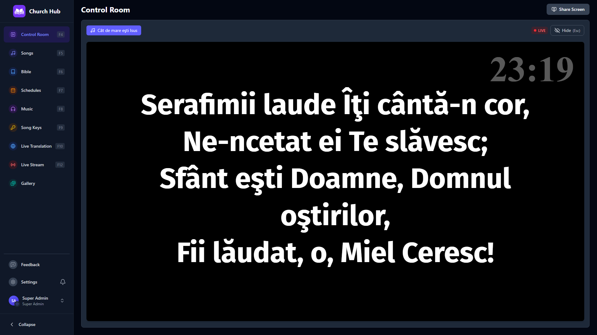

> Main presentation interface with live preview

- ▶️ **Live Preview** — See exactly what's displayed on screen
- ⌨️ **Keyboard Navigation** — Arrow and page keys move the live slide, even from a search box
- 🖱️ **Presenter Remote** — A clicker moves the slides; its black button hides the screen
- 🌫️ **Smooth Transitions** — Slides and Bible verses fade in calmly
- 🖥️ **Multi-Screen** — Primary, stage, livestream & kiosk outputs

---

### 🎵 Songs Library

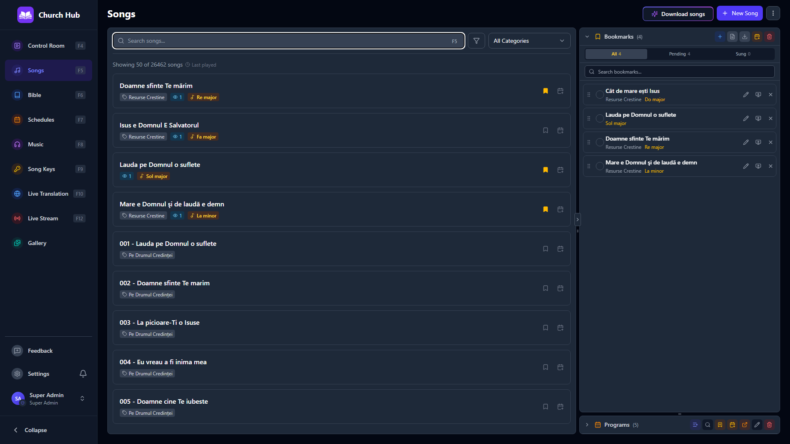

> Browse and search through 26,000+ songs instantly

- 🔍 **Typo-Tolerant Search** — Finds a word in any spelling, title matches first
- 🏷️ **Categories & Tags** — Organize with categories and audience tags (youth, choir, children)
- 🔖 **Marcaje** — Bookmark the songs for the service, also editable as plain text (Markdown)
- 📋 **Programs Panel** — Load a program's songs into Marcaje in one click
- 🌐 **Download Songs** — Find and import new songs from online sources
- 📥 **Smart Import** — OpenSong & PowerPoint formats, or drop the files on the window
- 🔄 **Duplicate Detection** — Prevents duplicates automatically

---

### 📝 Song Viewer

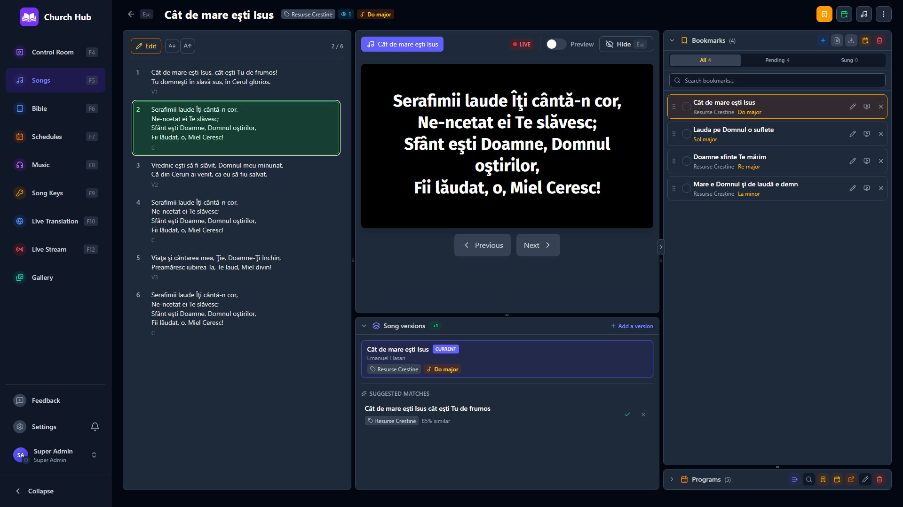

> View and present song lyrics with slide navigation

- 📑 **Slide Navigation** — Easy verse/chorus switching
- 🎼 **Song Key** — The key shows next to the title, in Marcaje and on program rows
- 🔗 **Song Versions** — Link versions of the same song, with suggested matches
- 📄 **PDF & Word Export** — Print a song's lyrics in one click
- ➕ **Add to Program** — One-click add to a service program

---

### ✏️ Song Editor

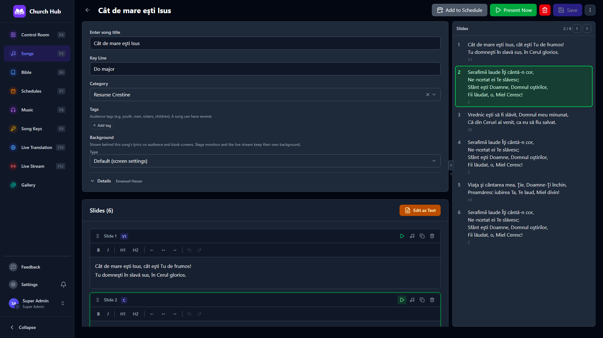

> Edit lyrics, details and the background of a song

- 🧩 **Side-by-Side Layout** — Slides on the right with a fixed title; panels can be moved and resized
- 📝 **Edit as Text** — Write the whole song as plain text with markers (V1, C, B)
- ▶️ **Present Any Slide** — A Present button on each slide
- 🖼️ **Song Background** — Pick an image or video for each song
- 📋 **CCLI Support** — Track license & copyright info

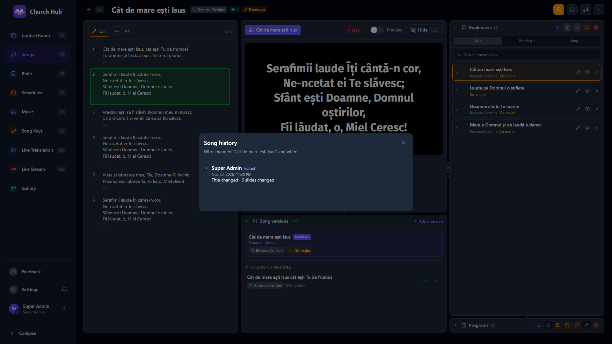

- 🕓 **Song History** — See who changed a song and when, and restore an older version

---

### 📖 Bible

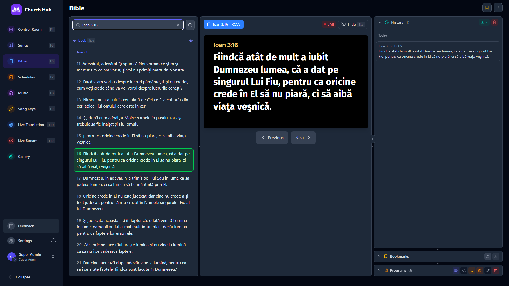

> Search and display Bible verses with live preview

- 🔎 **Smart Search** — By reference (`Ioan 3:16`, `Ioan 3:16,17`) or keyword
- 📚 **Multiple Translations** — Support for various versions
- 🔖 **Verse Bookmarks** — Bookmark verses, import and export them as text
- 🕓 **History** — The verses shown, exportable after the service
- 👁️ **Live Preview** — See verses before presenting

---

### 📋 Service Programs

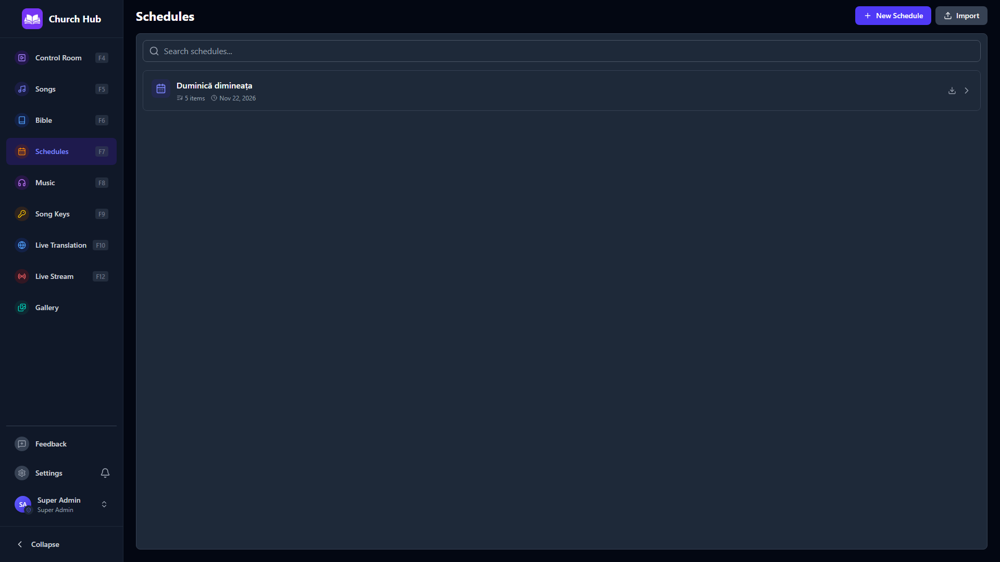
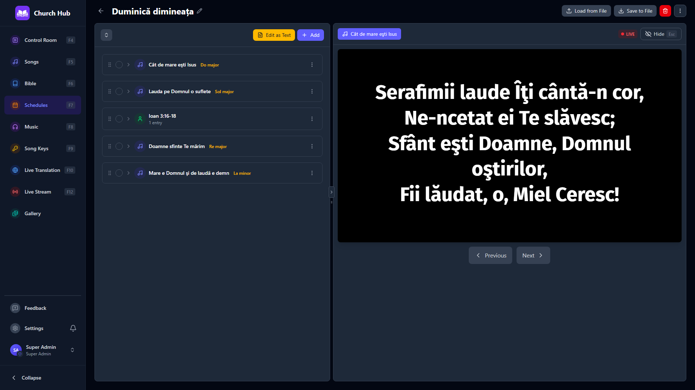

> Create and manage service schedules

- 📝 **Schedule Builder** — Songs, Bible readings & custom slides in one list
- 🎼 **Song Keys** — Each song's key on its row, editable in place and kept in exports
- ⚡ **Quick Insert** — Add a song or verse between any two entries
- 🖱️ **Drag & Drop** — Intuitive item reordering
- 💾 **Import/Export** — Share programs as files or text

---

### 🔴 Live Stream

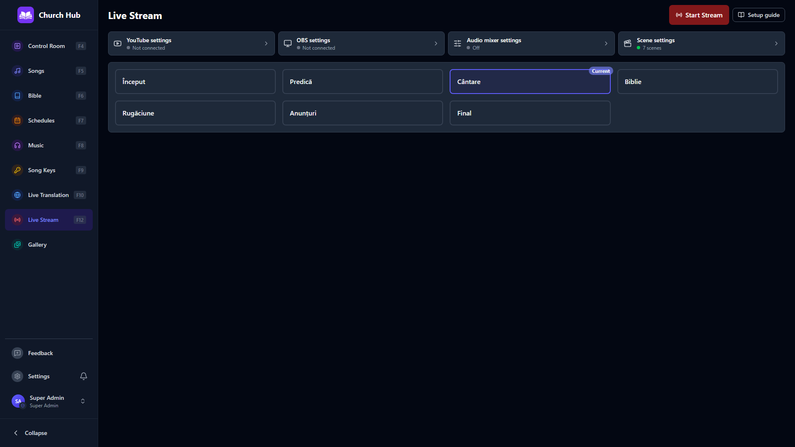

> YouTube livestream and OBS Studio integration

- ▶️ **One-Click Start** — Launch YouTube broadcasts
- 🎬 **OBS Scenes** — Ready-made scenes, switched from the app
- 🧭 **Setup Guide** — Step by step from OBS to the first scene
- 🤖 **Auto-Switch** — Scenes change with content type
- 🎚️ **Mixer Control** — Audio mixer integration (16+ ch)

---

### 🎵 Music Player

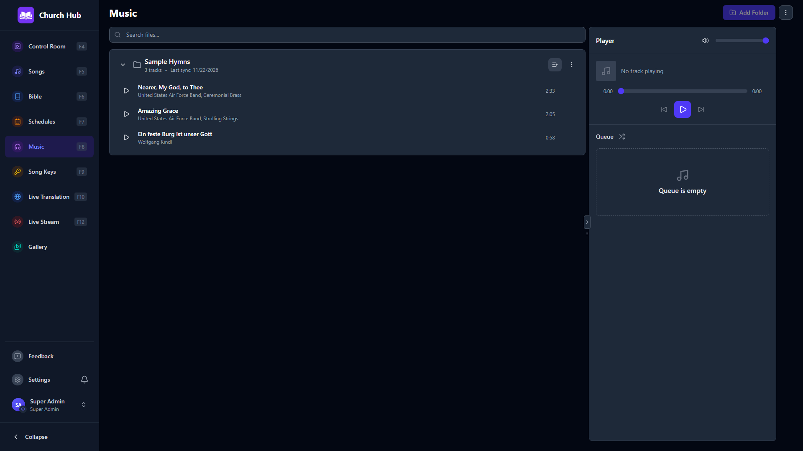

> Background music player for worship services

- 📁 **Folder Support** — Organize music by folders
- 🎵 **Queue Management** — Build and manage playlists
- 🔀 **Shuffle Mode** — Randomize playback order
- 🔊 **Volume Control** — Independent volume slider
- ▶️ **Playback Controls** — Play, pause, skip tracks

---

### 🎹 Song Keys

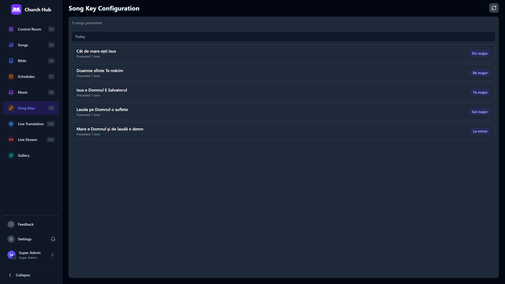

> Track recently presented songs with their musical keys

- 🎼 **Key Display** — Shows musical key for each song
- 📊 **Usage Stats** — Track how often songs are presented
- 📅 **Timeline View** — Organized by date (Today, Yesterday, etc.)
- 🎸 **For Musicians** — Quick reference for band members

---

### 🖼️ Gallery

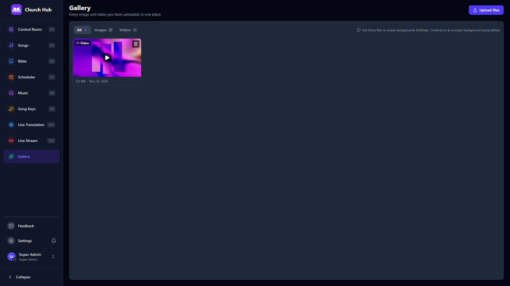

> Every background image and video in one place

- 📤 **Upload** — Images and videos for screens and songs
- 🎞️ **Video Backgrounds** — Looping videos behind the lyrics

---

### 🎨 Screen Editor

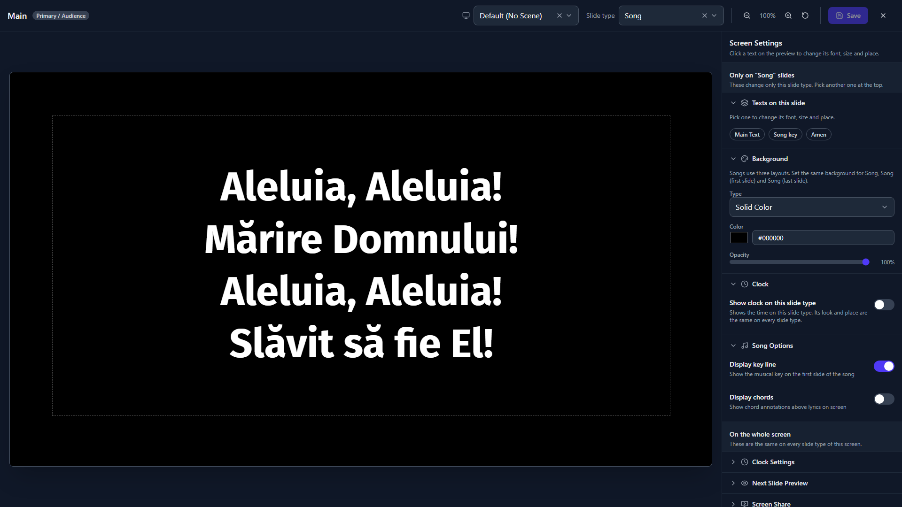

> Visual WYSIWYG editor for customizing presentation layouts

- 📐 **Visual Positioning** — Drag & resize elements on canvas
- 🔤 **Text Styling** — Font, size, color, alignment & shadows, with bundled fonts
- 🎼 **First & Last Slides** — Key and "Amin" layouts for the start and end of a song
- ✨ **Animations** — Fade, slide & zoom transitions for elements
- 📏 **Auto-Scaling** — Text automatically fits container bounds
- 🎬 **OBS Browser Source** — Embed URL for livestream captions
- 🖥️ **Multi-Layout** — Edit primary, stage & livestream screens

---

### 🖥️ Screens

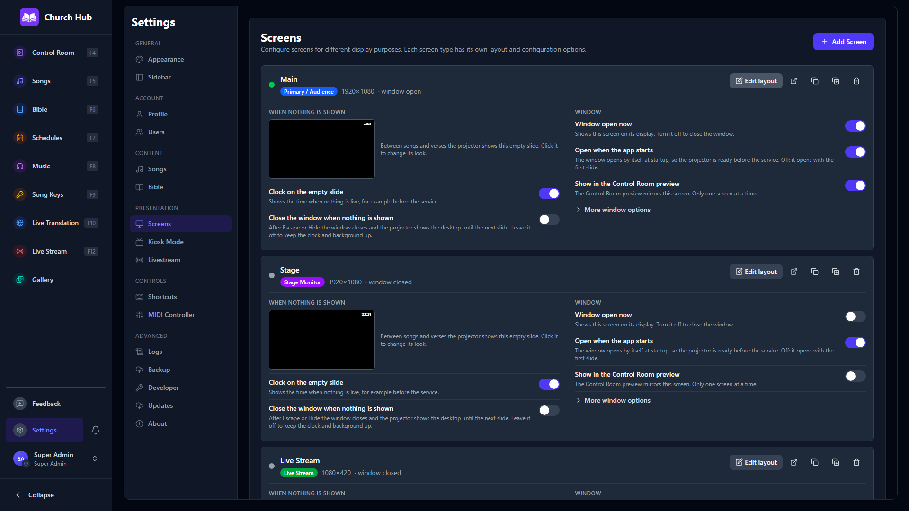

> Configure presentation screens

- 📺 **Multi-Screen Setup** — Main, Stage, Livestream & Kiosk displays
- 🚀 **Open at Startup** — Each screen can open by itself when the app starts
- 🕐 **Clock** — The time on the empty slide, before the service
- 🔢 **Identify** — Each display shows its number and name
- 🪟 **Window Management** — Launch screens as separate windows
- 📤 **Export/Import** — Share screen configurations

---

### ⚙️ Settings

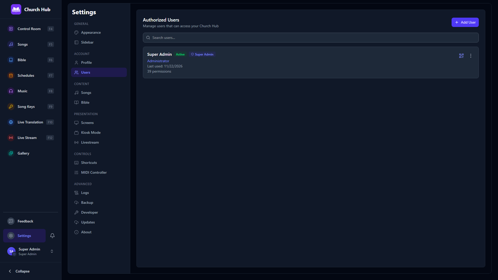

> Configure users, shortcuts and preferences

- 👥 **User Management** — Roles & permissions
- 📱 **QR & LAN Login** — Phones and tablets sign in with a pairing code
- ⌨️ **Shortcuts & MIDI** — Custom keys and MIDI controllers for slides and the live stream
- 🧭 **Sidebar Editor** — Reorder the menu, add custom pages with icons and colours
- 🔄 **In-App Updates** — Download and install new versions, with release notes
- 📜 **Logs** — Colour-coded logs with level filters and search
- 🌙 **Dark Mode** — Beautiful dark interface
- 🌍 **Multi-Language** — English & Romanian

---

### 💾 Backup

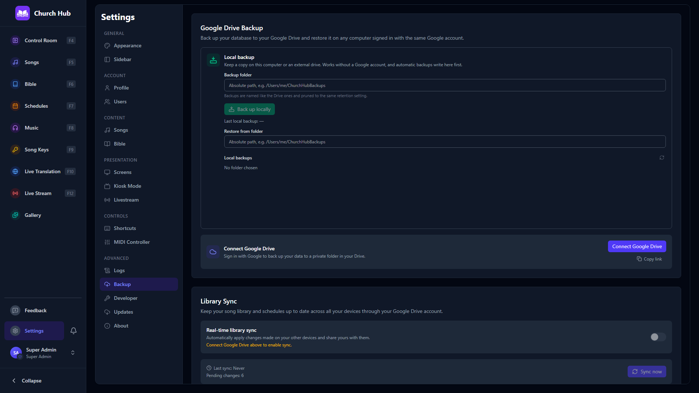

> Keep the library safe

- 📁 **Local Backups** — To any folder or external drive, and restore from one
- ☁️ **Google Drive** — Back up and restore on any computer
- 🔄 **Library Sync** — Keep songs and programs in step across devices

---

### 💬 Feedback

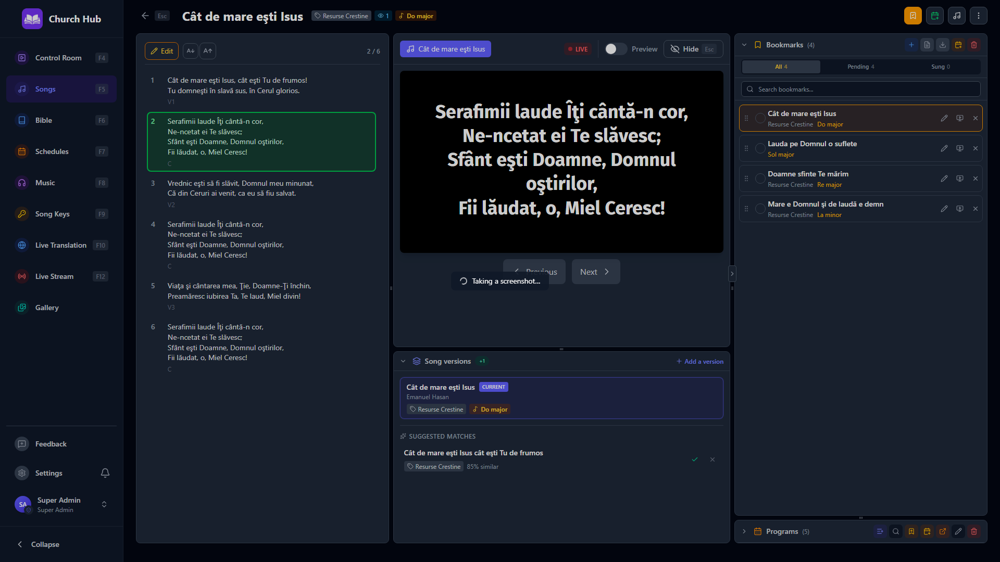

> Request a feature or report a bug from inside the app

- 📸 **Screenshot & Notes** — Capture the page, draw on it and add a note
- 🔔 **Notifications** — Updates and replies in one place, behind the bell in the sidebar

---

### 🌐 More

- 🗣️ **Live Translation** — Translated sermon text and audio for listeners on their own phones
- ↩️ **Back & Forward** — Mouse side buttons, Alt+Left/Right (Cmd+[ / Cmd+] on macOS), everywhere

---

## 🛠️ Tech Stack

<table>
  <tr>
    <td valign="top">
      <h4>🎨 Frontend</h4>
      <ul>
        <li><b>React 19</b></li>
        <li><b>TypeScript</b></li>
        <li><b>Vite</b></li>
        <li><b>TailwindCSS 4</b></li>
        <li><b>TanStack Router</b></li>
      </ul>
    </td>
    <td valign="top">
      <h4>⚙️ Backend</h4>
      <ul>
        <li><b>Bun</b></li>
        <li><b>Drizzle ORM</b></li>
        <li><b>SQLite</b></li>
        <li><b>WebSocket</b></li>
        <li><b>OpenAPI 3.1</b></li>
      </ul>
    </td>
    <td valign="top">
      <h4>🖥️ Desktop</h4>
      <ul>
        <li><b>Tauri 2.9</b></li>
        <li><b>Rust</b></li>
      </ul>
    </td>
    <td valign="top">
      <h4>🔌 Integrations</h4>
      <ul>
        <li><b>YouTube API</b></li>
        <li><b>OBS WebSocket</b></li>
        <li><b>MIDI</b></li>
      </ul>
    </td>
  </tr>
</table>

---

## 🚀 Getting Started

### Prerequisites

- [Node.js](https://nodejs.org/) (v18+)
- [Bun](https://bun.sh/) (v1.0+)
- [Rust](https://rustup.rs/) (for Tauri builds)

### Installation

```bash
# Clone the repository
git clone https://github.com/radio-crestin/church-hub.git
cd church-hub/app

# Install dependencies
npm install

# Start development (web only)
npm run dev:web

# Start development (desktop app)
npm run dev
```

### Access

Ports: the **dev server runs on 3001**; the installed app keeps **3000** (phones and remote screens connect to it). Different ports let both run at once: each Church Hub frees its own port on start.

- 🌐 **Web (dev)**: http://localhost:3001 (installed app: http://localhost:3000)
- 📚 **API Docs (dev)**: http://localhost:3001/api/docs

### Logs Path

Application logs are stored at:

| Platform | Path |
|----------|------|
| Windows | `C:\Users\<YOUR_USERNAME>\AppData\Local\church-hub\logs` |
| macOS | `~/Library/Application Support/church-hub/logs` |
| Linux | `~/.config/church-hub/logs` |

---

## 📜 Scripts

| Script | Description |
|--------|-------------|
| `npm run dev` | 🖥️ Desktop development |
| `npm run dev:web` | 🌐 Web development |
| `npm run build:apps` | 📦 Production build |
| `npm run tauri:build` | 🖥️ Desktop build |

---

## 🤝 Contributing

1. 🍴 Fork the repository
2. 🌿 Create your feature branch
3. 💾 Commit your changes
4. 📤 Push to the branch
5. 🔃 Open a Pull Request

---

## 📄 License

MIT License - see [LICENSE](LICENSE) for details.

---

<p align="center">
  Made with ❤️ for churches everywhere
</p>
